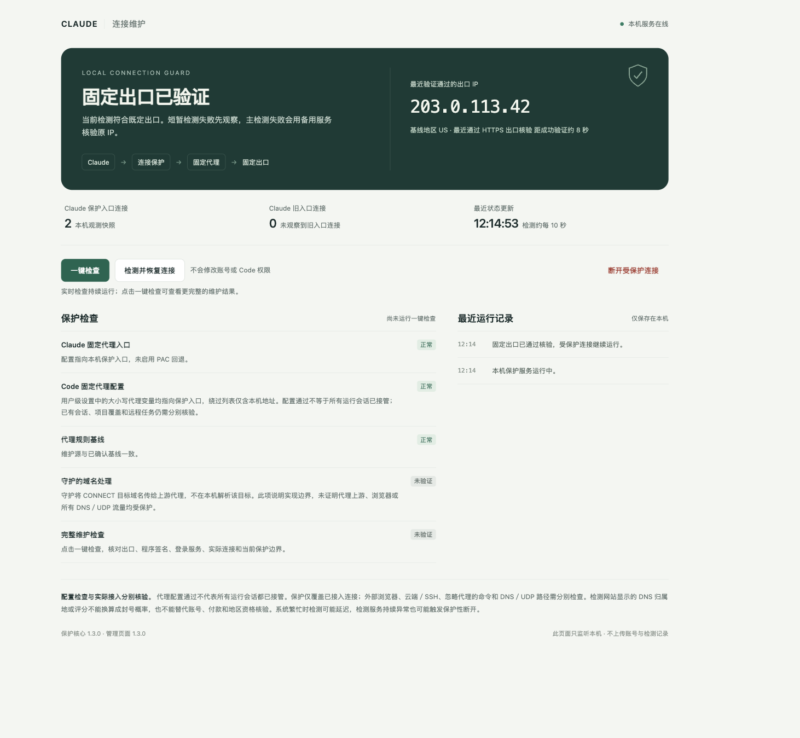
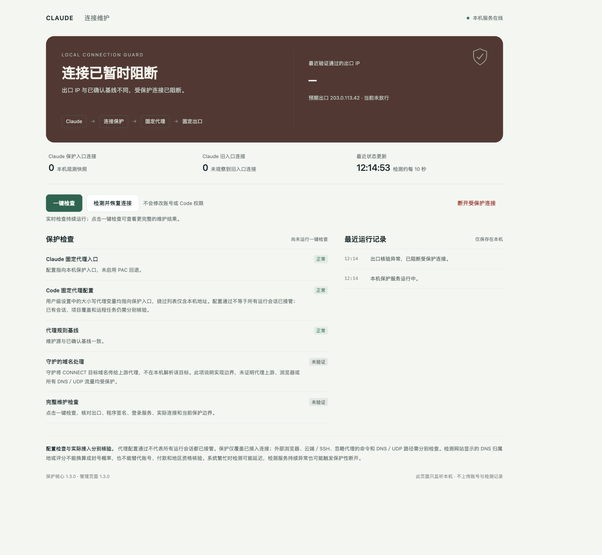
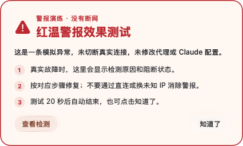

# Claude 防封守护盾 · Claude Shield

**为 Claude Desktop 和本地 Claude Code 的连接，加一道可观察的本机守护。**

[项目介绍](https://suhongshuo6-cell.github.io/claude-shield/) · [功能与边界](#它能做什么) · [构建与测试](#构建与隔离测试) · [问题反馈](https://github.com/suhongshuo6-cell/claude-shield/issues)



> 上图为开源版管理页面在隔离环境中的演示。地址 `203.0.113.42` 是文档示例地址，连接数和记录均为模拟数据；截图不代表真实网络状态。

Claude Shield 是一个面向 macOS 的**本机连接守护实验项目**。它位于已配置的本地代理之前，检查预期出口和配置基线；当检测结果明确异常或持续无法验证时，对已接入的连接执行保护性阻断，并在本机页面展示状态。

> **“防封守护盾”是项目名称，不是防封承诺。** 本工具不能保证账号不被封禁，也不能判断账号资格或平台政策。保护只覆盖实际接入网关的连接；外部浏览器、远程任务和绕过入口的流量需分别核验。

## 界面与警报

### 连接异常时

当守护判定出口或配置异常，管理页面会显示阻断状态和原因，帮助你区分连接问题与需要进一步核验的项目。



### 原生警报演练

下面是本机桌宠配套工具的警报演练界面：异常时可以提示原因和处理步骤。此图使用模拟状态，没有切断真实连接，也没有使用真实账号或网络配置。



**桌宠和原生警报属于独立的本机配套工具，未包含在当前开源仓库或安装包中。** 上图只展示配套工具的演练界面，不代表克隆本仓库即可获得桌宠、声音提醒或该弹窗。截图未包含第三方角色立绘。

## 它能做什么

| 能力 | 说明 |
| --- | --- |
| 出口与配置核验 | 检查预期出口 IP、地区、检测响应时效和指定配置基线；有效结果明确不符时阻断。 |
| 短暂波动观察 | 短暂探测失败先进入观察窗口，持续无法验证时关闭已接入连接；不是零延迟的全局防火墙。 |
| 本机连接网关 | 将已接入的 HTTPS CONNECT 请求转发到本地上游代理，不解密业务 TLS，也不提供直连回退。 |
| 配置与状态展示 | 检查 Claude Desktop 原生代理及可选的 Claude Code 用户级代理设置，展示检查结果和本机运行记录。 |
| 手动操作 | 本机管理页面提供检查、恢复和断开入口；恢复仍须满足守护的出口验证条件。 |

## 它如何工作

```text
Claude Desktop / 已配置的本地 Claude Code
                  │
                  ▼
          Claude Shield 本机入口
          核验出口与配置基线
                  │
                  ▼
          已有的本地上游代理
                  │
                  ▼
              目标服务
```

守护启动时先保持关闭，通过验证后才放行；检测发现有效的出口或受保护配置偏离时，会关闭已接入的连接并拒绝新连接。短暂探测失败会先观察，持续失败才触发保护性断开。出口变化必须等待检测结果，检测服务或上游代理故障也可能导致中断。

## 当前阶段

这是从个人环境整理出的**源码与隔离测试**，还不是通用安装包。使用者需要自行准备上游代理、建立出口及配置基线、适配 Claude 客户端设置，并验证实际会话是否经过保护入口。仓库不包含生产配置或自动安装工具；原环境专用的 Surge 自动恢复在公开版本中已关闭，部分状态检查仍需针对其他环境审阅和适配。

需要 macOS、Xcode Command Line Tools、Python 3 和 OpenSSL。构建生成的是本地临时签名的二进制，并非经过 Apple 公证的分发包。

## 构建与隔离测试

在项目目录运行：

```sh
python3 build.py
python3 tests/integration.py
python3 tests/console_test.py
```

隔离测试使用本机 TCP / TLS 模拟环境，不发起 Claude 账号请求，也不修改生产设置。测试覆盖连接阻断、恢复、配置变化和管理页面访问控制等场景。运行前请先审阅脚本；`build/` 是本地产物，不应上传其中的配置、日志或凭据。

## 保护范围

- **只保护已接入的连接。** Claude Code 项目级或命令行覆盖、已有进程、远程执行和外部浏览器可能不受用户级设置约束，需分别验证。
- **不等于整机 DNS / UDP 防护。** 网关处理已接入的 HTTPS CONNECT 请求，不证明所有 DNS、UDP 或其他应用流量都受到保护。
- **不提供代理或账号资格。** 使用者需自行管理代理、服务资格和地区政策；本项目不判断封号概率，也不修改账号状态。
- **配置通过不等于实际全覆盖。** 页面中看到的配置检查、网络探测和实际会话接入情况是不同的证据，应分别核对。

## 项目结构

```text
claude-shield/
├── src/                 # 本机连接网关、管理服务和页面
├── tests/               # 不接触生产服务的隔离回归测试
├── docs/index.html      # 项目介绍页
├── docs/images/         # 使用示例数据生成的界面截图
├── build.py             # 本机构建脚本
└── LICENSE              # MIT 许可证
```

## 隐私与反馈

仓库不包含个人出口地址、DNS 配置、代理凭据、账号信息、生产日志或本机部署记录。截图使用文档示例地址和模拟数据。提交 [Issue](https://github.com/suhongshuo6-cell/claude-shield/issues) 时，请先移除 IP、代理地址、账号凭据和其他敏感信息。

Claude 是 Anthropic 的商标；本项目与 Anthropic 无关联，也不代表官方认可。代码采用 [MIT 许可证](LICENSE)。
